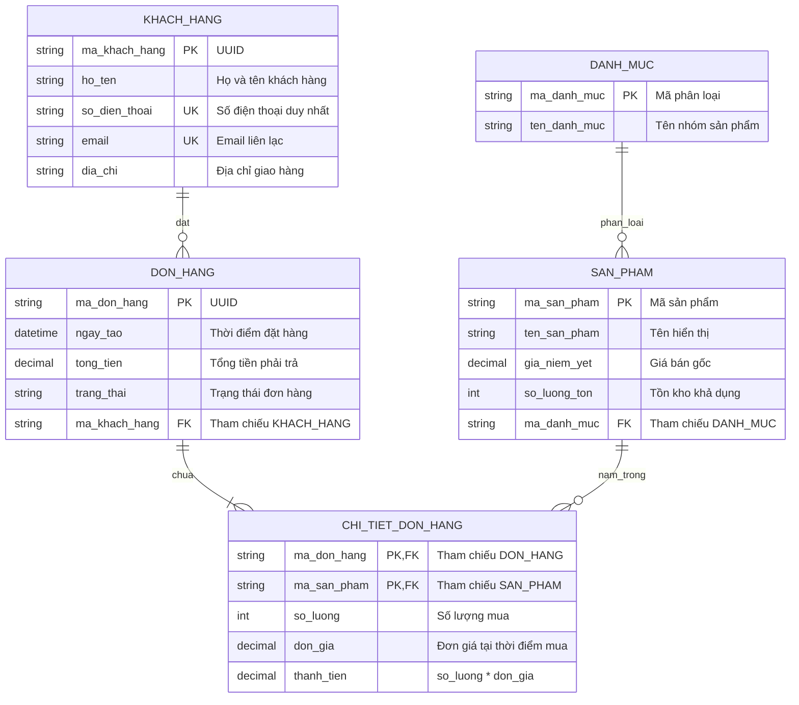

# Cẩm Nang Thiết Kế Mô Hình Dữ Liệu Quan Hệ & Chuẩn Hóa 3NF

Tài liệu này cung cấp hướng dẫn chuyên sâu về các bước chuẩn hóa cơ sở dữ liệu quan hệ, các chiến lược ánh xạ quan hệ thừa kế hướng đối tượng sang CSDL và cú pháp biểu diễn ERD chuẩn.

---

## 1. Lý Thuyết Phụ Thuộc Hàm & Quy Trình Chuẩn Hóa 3NF

### 1.1. Khái Niệm Phụ Thuộc Hàm (Functional Dependency)
Cho lược đồ quan hệ $R(A_1, A_2, ..., A_n)$ và hai tập thuộc tính $X, Y \subseteq R$.
Ta nói rằng $X$ xác định hàm $Y$ (ký hiệu $X \rightarrow Y$) nếu với mọi cặp bộ giá trị $t_1, t_2 \in R$, nếu $t_1[X] = t_2[X]$ thì $t_1[Y] = t_2[Y]$.

### 1.2. Ví Dụ Chuyển Hóa Chi Tiết Từng Bước (Case Study)

Xét lược đồ ban đầu thu được từ việc bóc tách hóa đơn bán hàng chưa chuẩn hóa:
$$\text{HoaDonChuaChuanHoa}(\underline{\text{MaHoaDon}}, \text{NgayLap}, \text{MaKhachHang}, \text{TenKhachHang}, \text{DiaChiKhach}, \underline{\text{MaSanPham}}, \text{TenSanPham}, \text{DonGia}, \text{SoLuong}, \text{ThanhTien})$$

* **Bước 1: Đưa về Dạng chuẩn 1 (1NF)**
  * *Vấn đề:* Thuộc tính danh sách sản phẩm lặp lại nhiều dòng cho mỗi hóa đơn.
  * *Giải pháp:* Tách thành bảng phẳng có khóa chính phức hợp gồm `(MaHoaDon, MaSanPham)`. Mọi trường đều chứa giá trị nguyên tử đơn nhất.
* **Bước 2: Đưa về Dạng chuẩn 2 (2NF)**
  * *Phân tích phụ thuộc hàm:*
    * Toàn phần: $(\text{MaHoaDon}, \text{MaSanPham}) \rightarrow \text{SoLuong}, \text{ThanhTien}$
    * Phụ thuộc một phần: $\text{MaHoaDon} \rightarrow \text{NgayLap}, \text{MaKhachHang}, \text{TenKhachHang}, \text{DiaChiKhach}$
    * Phụ thuộc một phần: $\text{MaSanPham} \rightarrow \text{TenSanPham}, \text{DonGia}$
  * *Khắc phục:* Tách thành 3 quan hệ độc lập:
    1. $\text{HoaDon}(\underline{\text{MaHoaDon}}, \text{NgayLap}, \text{MaKhachHang}, \text{TenKhachHang}, \text{DiaChiKhach})$
    2. $\text{SanPham}(\underline{\text{MaSanPham}}, \text{TenSanPham}, \text{DonGia})$
    3. $\text{ChiTietHoaDon}(\underline{\text{MaHoaDon}}, \underline{\text{MaSanPham}}, \text{SoLuong}, \text{ThanhTien})$
* **Bước 3: Đưa về Dạng chuẩn 3 (3NF)**
  * *Phân tích phụ thuộc bắc cầu:*
    * Trong quan hệ $\text{HoaDon}$, ta có: $\text{MaHoaDon} \rightarrow \text{MaKhachHang}$, và $\text{MaKhachHang} \rightarrow \text{TenKhachHang}, \text{DiaChiKhach}$.
    * Do $\text{MaKhachHang}$ không phải là siêu khóa của $\text{HoaDon}$, đây là phụ thuộc hàm bắc cầu vi phạm 3NF.
  * *Khắc phục:* Tách bảng khách hàng riêng:
    1. $\text{KhachHang}(\underline{\text{MaKhachHang}}, \text{TenKhachHang}, \text{DiaChiKhach})$
    2. $\text{HoaDon}(\underline{\text{MaHoaDon}}, \text{NgayLap}, \text{MaKhachHang})$ (với $\text{MaKhachHang}$ là khóa ngoại tham chiếu sang bảng $\text{KhachHang}$).
  * *Kết quả cuối cùng:* Toàn bộ hệ thống đạt chuẩn 3NF với 4 bảng: `KhachHang`, `HoaDon`, `ChiTietHoaDon`, `SanPham`.

---

## 2. Chiến Lược Ánh Xạ Kế Thừa Sang CSDL Quan Hệ (Inheritance Mapping)

Khi Class Diagram có quan hệ tổng quát hóa/kế thừa (ví dụ: `NguoiDung` là lớp cha, `KhachHang` và `NhanVien` là lớp con), có 3 chiến lược ánh xạ sang CSDL:

| Chiến lược | Cơ chế tổ chức bảng | Ưu điểm | Nhược điểm & Khi nào dùng |
| :--- | :--- | :--- | :--- |
| **Bảng đơn nhất (Single Table)** | Gom toàn bộ lớp cha và lớp con vào 1 bảng duy nhất, dùng cột phân loại `loai_nguoi_dung` (`DISCRIMINATOR`). | Truy vấn cực nhanh, không cần `JOIN`. | Bảng có nhiều cột `NULL` lãng phí bộ nhớ. Phù hợp khi các lớp con có ít thuộc tính riêng biệt. |
| **Bảng lớp liên kết (Class Table)** | Lớp cha thành 1 bảng, mỗi lớp con thành 1 bảng riêng có khóa chính vừa là khóa ngoại trỏ về khóa chính của cha. | Không có cột `NULL`, chuẩn hóa dữ liệu cao, cấu trúc trong sáng. | Bắt buộc phải `JOIN` khi lấy thông tin đầy đủ. **Đây là phương án ưu tiên chuẩn học thuật cho đồ án**. |
| **Bảng thực thể cụ thể (Concrete Table)** | Không tạo bảng cho lớp cha, mỗi lớp con tạo thành 1 bảng độc lập chứa toàn bộ thuộc tính của cha + con. | Không cần `JOIN` khi truy vấn từng loại đối tượng cụ thể. | Trùng lặp cấu trúc cột, khó quản lý quan hệ đa hình. |

---

## 3. Mẫu Cú Pháp Biểu Biểu Diễn ERD Bằng Mermaid

