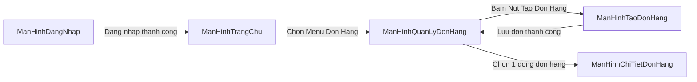

# Kỹ Năng Thiết Kế Wireframe & Luồng Giao Diện (`system-analysis-ui`)

Kỹ năng này thuộc **Nhóm Tier 2**, chịu trách nhiệm chuyển hóa các kịch bản tương tác Use Case (`02-yeu-cau-va-use-case.md`) và biểu đồ tuần tự (`05-bieu-do-tuan-tu.md`) thành sơ đồ điều hướng màn hình (Screen Flow) và bản vẽ Wireframe mức phác thảo thấp (Low-fidelity) tại `PTTKHTTT/11-thiet-ke-giao-dien-wireframe.md`. Kỹ năng sử dụng kết hợp bảng Markdown và bố cục ASCII trực quan, xem xét 5 trạng thái giao diện và chuẩn hóa tên màn hình, nút bấm theo chuẩn PascalCase.

---

## 1. Vai Trò & Ranh Giới Trách Nhiệm

* **Trách nhiệm chính:**
  * Lập danh mục toàn bộ màn hình giao diện của hệ thống từ danh sách Use Case.
  * Xây dựng sơ đồ điều hướng chuyển đổi giữa các màn hình (Screen Navigation Flow).
  * Vẽ phác thảo cấu trúc bố cục Wireframe mức thấp (Low-fi) bằng khung văn bản ASCII kết hợp bảng Markdown mô tả chi tiết.
  * Xem xét và thiết kế 5 trạng thái giao diện (`Loading`, `Empty`, `Error`, `Success`, `Validation`) cho các màn hình nghiệp vụ trọng tâm.
  * Chuyển giao cấu trúc layout và Screen Flow sang cho `/draw-diagram` khi người dùng yêu cầu biểu đồ Wireframe Draw.io đồ họa trực quan.
* **Ranh giới (Điều kỹ năng này KHÔNG làm):**
  * Không viết mã giao diện HTML/CSS/Tailwind hay chọn thư viện UI cụ thể (React, Vue, Flutter).
  * Không thiết kế đồ họa mức cao (High-fidelity mockup với màu sắc, typography phức tạp trên Figma).

---

## 2. Đầu Vào & Đầu Ra

* **Đầu vào:**
  * Tệp đặc tả yêu cầu và Use Case: `PTTKHTTT/02-yeu-cau-va-use-case.md`.
  * Biểu đồ tuần tự: `PTTKHTTT/05-bieu-do-tuan-tu.md`.
* **Đầu ra:**
  * Tệp tài liệu hoàn chỉnh: `PTTKHTTT/11-thiet-ke-giao-dien-wireframe.md`.
  * Sơ đồ điều hướng màn hình (Mermaid `flowchart LR`) lưu tại `PTTKHTTT/models/11-luong-giao-dien.mmd`.
  * Danh mục bản vẽ ASCII Wireframe kèm bảng đặc tả thành phần giao diện.
  * Biểu đồ Draw.io Wireframe XML tại `PTTKHTTT/xml/11-thiet-ke-giao-dien-wireframe.drawio.xml` và hình ảnh tại `PTTKHTTT/diagrams/` thông qua `draw-diagram`.

---

## 3. Quy Trình Thiết Kế Giao Diện Wireframe (4 Bước)

```
[B1: Trích xuất màn hình] ──> [B2: Vẽ Screen Flow] ──> [B3: Vẽ ASCII Wireframe]
                                                                  │
[B5: Chuẩn hóa PascalCase] <── [B4: Xem xét 5 trạng thái UI] <─────┘
```

### Bước 1: Trích xuất danh mục màn hình từ Use Case (Screen Inventory)
* Ánh xạ mỗi Use Case chính sang một hoặc nhiều màn hình tương tác:
  * `UC-01` (`DangNhap`) → `ManHinhDangNhap`.
  * `UC-02` (`TaoDonHang`) → `ManHinhQuanLyDonHang` (Danh sách) và `ManHinhTaoDonHang` (Biểu mẫu tạo mới).
  * `UC-03` (`TraCuuSanPham`) → `ManHinhTraCuuSanPham`.
* Quy chuẩn đặt tên màn hình: Bắt buộc dùng tiền tố `ManHinh` kết hợp tên nghiệp vụ PascalCase không dấu (ví dụ: `ManHinhChiTietDonHang`, `ManHinhBaoCaoDoanhThu`).

### Bước 2: Xây dựng sơ đồ điều hướng luồng màn hình (Screen Flow)
* Biểu diễn trực quan các mũi tên chuyển màn hình dựa trên hành vi bấm nút của người dùng bằng Mermaid `flowchart LR`:



### Bước 3: Phác thảo Wireframe bằng bảng Markdown & khung ASCII
* Sử dụng khung viền ASCII kết hợp các ký hiệu trực quan:
  * Nút bấm: `[ Tên Nút ]`
  * Ô nhập liệu: `[___________]`
  * Ô tích chọn: `[x]`, `[ ]`
  * Menu thả xuống: `[ Lua Chon v ]`
  * Bảng dữ liệu: Thể hiện dạng lưới hàng cột trực quan.
* Đi kèm bên dưới mỗi bản vẽ ASCII là một bảng Markdown định nghĩa rõ các thành phần:

| Mã thành phần | Loại thành phần | Nhãn hiển thị | Ràng buộc nghiệp vụ / Hành vi |
| :--- | :--- | :--- | :--- |
| `NutTaoDonHang` | Button (Primary) | "Tạo đơn hàng mới" | Điều hướng sang `ManHinhTaoDonHang` |
| `OTextInputTimKiem` | Input (Text) | "Nhập mã đơn, tên khách..." | Lọc kết quả tìm kiếm tức thời |
| `BangDanhSachDonHang`| Table (Data grid) | Danh sách đơn hàng | Có phân trang 10 dòng/trang |

### Bước 4: Xem xét 5 trạng thái giao diện (The 5 UI States)
Không bắt buộc áp dụng máy móc 5 trạng thái cho toàn bộ các màn hình tĩnh đơn giản. Tuy nhiên, đối với các màn hình có tương tác nghiệp vụ dữ liệu chính, bắt buộc phải xem xét và mô tả cách xử lý khi rơi vào các tình huống:
1. **Trạng thái Đang tải (`Loading`):** Hiển thị thanh tiến trình hoặc khung xương (Skeleton) khi dữ liệu đang được truy vấn.
2. **Trạng thái Trống (`Empty`):** Khi bảng chưa có dữ liệu (ví dụ: người dùng mới chưa có đơn hàng nào), hiển thị thông điệp thân thiện kèm nút bấm dẫn dắt: *"Bạn chưa có đơn hàng nào. [ Bấm vào đây để tạo đơn đầu tiên ]"*.
3. **Trạng thái Lỗi (`Error`):** Khi mất kết nối máy chủ hoặc API lỗi, hiển thị cảnh báo đỏ và nút `[ Thử lại ]`.
4. **Trạng thái Thành công (`Success`):** Hiển thị thông báo Toast thông báo thành công và cập nhật lại lưới dữ liệu.
5. **Trạng thái Xác thực (`Validation`):** Hiển thị dòng chữ cảnh báo màu đỏ ngay dưới ô nhập liệu khi người dùng nhập sai quy tắc `BR-xx` hoặc bỏ trống trường bắt buộc.

---

## 4. Chuyển Giao Cho Kỹ Năng Kết Xuất Biểu Đồ (`/draw-diagram`)

Khi người dùng cần kết xuất Wireframe đồ họa Draw.io trực quan:
* Lưu sơ đồ điều hướng màn hình (Mermaid `flowchart LR`) hoặc đặc tả bố cục tại `PTTKHTTT/models/11-luong-giao-dien.mmd`.
* Kích hoạt kỹ năng `/draw-diagram` để tiếp nhận danh mục màn hình và cấu trúc bố cục (Header, Sidebar, Form, Data Grid, Modal, và các trạng thái giao diện).
* `draw-diagram` sẽ bố trí container màn hình, căn chỉnh các widget con, kết xuất Draw.io XML tại `PTTKHTTT/xml/11-thiet-ke-giao-dien-wireframe.drawio.xml`, kiểm định hình học qua `validate_drawio_xml.ps1` và xuất ảnh sang `PTTKHTTT/diagrams/`.

*Xem các mẫu bố cục Wireframe ASCII chuẩn tại:* [wireframe-patterns.md](./references/wireframe-patterns.md)

